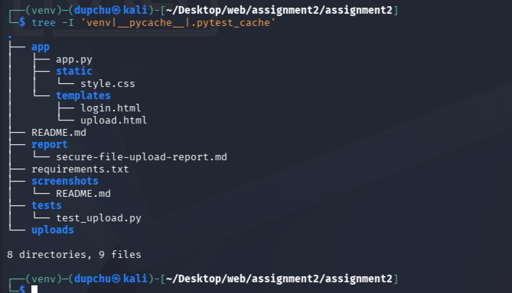
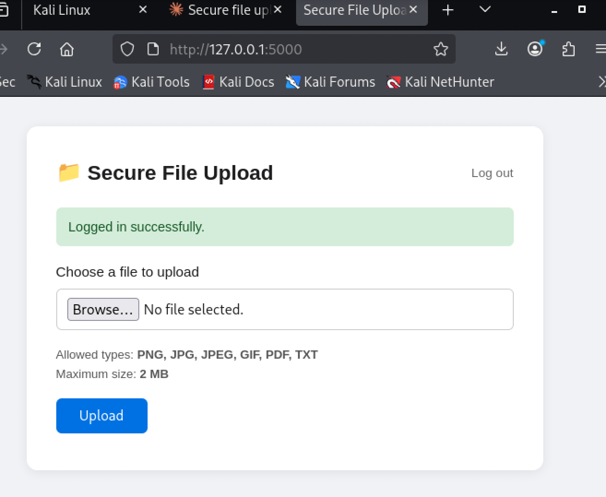
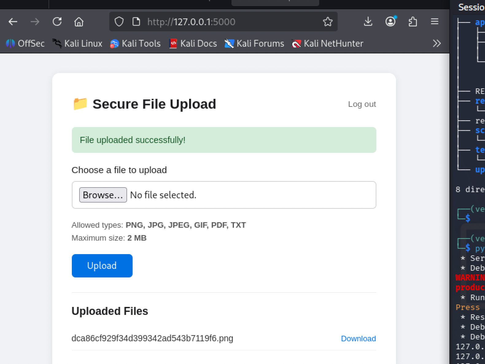
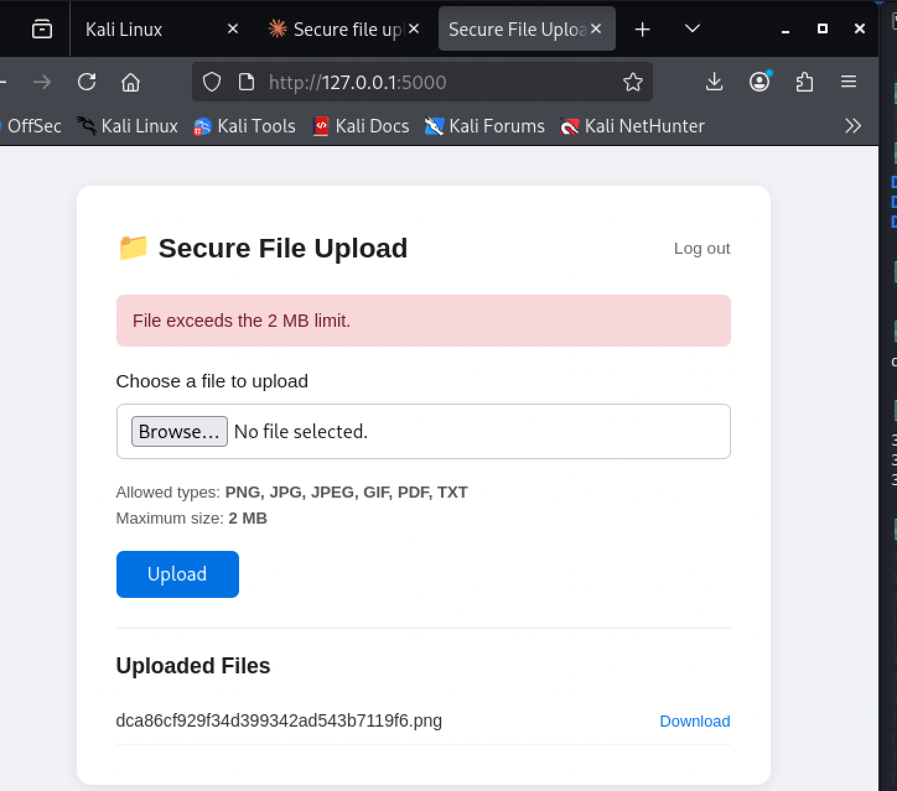
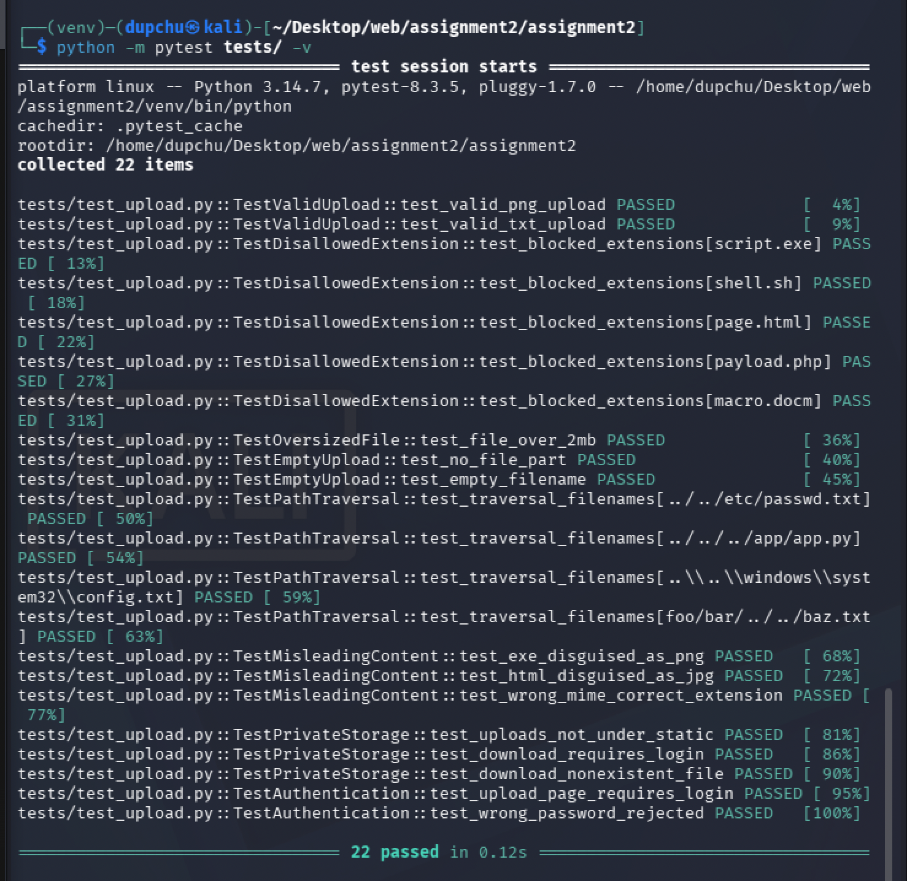

# WEB404 Assignment 2 – Secure File Upload


## 1. Aim and Objectives

**Aim:** Develop a file upload feature in a web application and implement security measures to prevent malicious file uploads.

**Objectives:**

- Build a functional Flask web application that accepts permitted file types and rejects dangerous ones.
- Implement at least ten distinct security controls following a defence-in-depth approach.
- Write automated tests that verify each control works correctly using harmless test payloads.
- Demonstrate understanding of why common shortcuts — such as checking only filenames or browser-reported MIME types — are insufficient.

## 2. Introduction

File upload functionality is one of the most commonly exploited features in web applications. OWASP ranks unrestricted file upload among critical web application risks. Attackers exploit weak upload validation to deliver web shells, overwrite server files through path traversal, trigger denial-of-service through oversized payloads, and bypass access controls to retrieve sensitive data.

A single-layer check is trivially defeated. For example, verifying only the file extension means an attacker can rename `shell.php` to `shell.png` and the check passes. Similarly, the `Content-Type` header sent by the browser is entirely under the attacker's control — a tool like `curl` can set it to any value — so it must never be trusted as the sole validation mechanism.

This assignment implements **defence-in-depth**: ten independent security layers working together so that if one check is bypassed, subsequent layers still block the attack. The application was developed using Python Flask and tested on a Kali Linux virtual machine, a penetration-testing distribution that provides a realistic environment for evaluating security controls.


## 3. Requirements and Technologies

| Component | Technology | Version |
|-----------|-----------|---------|
| Language | Python | 3.14.7 |
| Framework | Flask | 3.1.1 |
| CSRF protection | Flask-WTF | 1.2.2 |
| Testing | pytest | 8.3.5 |
| Operating system | Kali Linux (VM) | Rolling |
| Browser | Firefox ESR | Default in Kali |
| Editor | VS Code / terminal | — |

No database is used. This keeps the project small and focused on upload security rather than ORM configuration. Authentication uses hardcoded demo credentials for demonstration purposes only.


## 4. Project Structure

The project follows a clean separation between the application code, test suite, uploaded file storage, and documentation:

```
assignment2/
├── app/
│   ├── app.py              # Main Flask application with all security controls
│   ├── static/
│   │   └── style.css       # Presentation layer
│   └── templates/
│       ├── login.html       # Authentication form with CSRF token
│       └── upload.html      # Upload form with CSRF token
├── tests/
│   └── test_upload.py       # 22 automated security tests across 7 categories
├── uploads/                 # File storage directory (outside static/)
│   └── .gitkeep
├── screenshots/             # Evidence of running application
│   └── README.md
├── report/
│   └── secure-file-upload-report.md   # This report
├── requirements.txt
├── .gitignore
└── README.md
```

A critical design decision is that the `uploads/` directory sits at the project root, **outside** the `app/static/` directory. Flask automatically serves anything under `static/` to any browser request without authentication. Placing uploads inside `static/` would allow unauthenticated users to access or potentially execute uploaded files simply by guessing their URLs.



## 5. Implementation and Security Controls

This section describes each of the ten security controls implemented in the application, with code excerpts from `app/app.py`.



### Control 1 — Extension Allowlisting

```python
ALLOWED_EXTENSIONS = {"png", "jpg", "jpeg", "gif", "pdf", "txt"}
```



Only these six extensions are accepted. Every other extension is rejected before any further processing occurs. This is an **allowlist** approach rather than a blocklist — new dangerous extensions (e.g., `.phtml`, `.shtml`) do not need to be individually added because they are rejected by default.

During testing, I attempted to upload `malicious.php` from the Desktop. The application immediately displayed a red flash message: "File type not allowed. Permitted: gif, jpeg, jpg, pdf, png, txt."



### Control 2 — File Size Limit

```python
MAX_CONTENT_LENGTH = 2 * 1024 * 1024  # 2 MB
```

Flask enforces this limit at the WSGI layer. If the incoming request body exceeds 2 MB, Flask aborts the request with HTTP 413 before the full payload is read into memory. This mitigates denial-of-service attacks where an attacker floods the server with enormous files to exhaust disk space or memory.

I verified this by creating a 3 MB file using `dd if=/dev/zero of=~/Desktop/bigfile.txt bs=1M count=3` and attempting to upload it. The application displayed: "File exceeds the 2 MB limit."


### Control 3 — MIME-Type and Magic-Byte Validation

The browser sends a `Content-Type` header with every upload (e.g., `image/png`). The application checks this header as a first advisory layer, but does **not** trust it alone.

The authoritative check reads the first 8 bytes of the actual file content and compares them against known file signatures (magic bytes). For example, every valid PNG file begins with the bytes `\x89PNG\r\n\x1a\n`. If the actual bytes do not match the expected signature for the claimed extension, the file is rejected regardless of what the browser reported.

**Why checking only the filename or browser-provided MIME type is insufficient:**

- **Filename spoofing:** An attacker renames `exploit.php` to `exploit.png`. The extension check passes, but the file contains executable PHP code that a misconfigured server could run.
- **MIME-type spoofing:** The `Content-Type` header is set by the client, not the server. Running `curl -F "file=@shell.php;type=image/png"` sends a PHP script with a PNG MIME type. If the server checks only the header, it accepts a dangerous file.
- **Magic bytes** are embedded in the file itself and are much harder — though not impossible — to forge without corrupting the file format. Checking them provides an additional authoritative layer that browser headers cannot match.

For `.txt` files, which have no fixed magic signature, the application instead verifies that the entire file content is valid UTF-8. Binary executables disguised as `.txt` files would fail this check.

### Control 4 — Safe Filename Handling

```python
safe = secure_filename(original_filename)
```

Werkzeug's `secure_filename()` function strips directory separators (`/`, `\`), null bytes, and other dangerous characters from the user-supplied filename. This prevents a malicious filename like `../../etc/passwd` from writing files outside the intended upload directory (a path-traversal attack).

### Control 5 — Storage Outside the Web Directory

Uploaded files are stored in the `uploads/` directory at the project root, not inside `app/static/`. Flask's built-in static file server cannot reach them. There is no direct URL path that maps to the uploads folder, so uploaded files can only be retrieved through the authenticated `/download/<filename>` route.

### Control 6 — Randomised Server-Side Filenames

```python
def generate_safe_name(original_filename):
    safe = secure_filename(original_filename)
    ext = safe.rsplit(".", 1)[1].lower() if "." in safe else ""
    return f"{uuid.uuid4().hex}.{ext}"
```

After validation, the original filename is discarded entirely. A new name is generated using Python's `uuid.uuid4().hex`, preserving only the validated extension. This means no user-controlled string ever reaches the filesystem, attackers cannot predict filenames to access other users' uploads, and filename collisions are statistically impossible.

I confirmed this by uploading a file named `photo.png`. In the "Uploaded Files" list, it appeared as `dca86cf929f34d399342ad543b7119f6.png` — a UUID with no trace of the original name.

### Control 7 — Authentication Gate

```python
def login_required(f):
    @wraps(f)
    def decorated(*args, **kwargs):
        if not session.get("logged_in"):
            flash("Please log in first.", "warning")
            return redirect(url_for("login"))
        return f(*args, **kwargs)
    return decorated
```

A `login_required` decorator protects both the upload page (`/`) and the download route (`/download/<filename>`). Unauthenticated users are redirected to the login page. The demo uses hardcoded credentials (`admin` / `secure123`); a production system would use hashed passwords stored in a database.

### Control 8 — Safe Error Messages and Logging

Flash messages shown to users are generic and never reveal internal server paths, Python tracebacks, or configuration details. For example, a failed content validation shows "File rejected: File content does not match the expected format" — not the internal file path or the specific bytes that were read.

Meanwhile, the server logs detailed information for the administrator's audit trail:

```python
app.logger.warning(
    "Content validation failed for '%s': %s",
    secure_filename(file.filename),
    reason,
)
```

This separation ensures attackers cannot extract useful information from error messages while administrators still have full diagnostic data.

### Control 9 — CSRF Protection

```html
<input type="hidden" name="csrf_token" value="{{ csrf_token() }}">
```

Every form includes a hidden `csrf_token` field generated by Flask-WTF's `CSRFProtect`. POST requests without a valid, matching token are rejected with HTTP 400. This prevents Cross-Site Request Forgery attacks where a malicious third-party website tricks a logged-in user's browser into submitting an upload form without the user's knowledge.

### Control 10 — Attachment-Only File Serving

```python
return send_from_directory(
    app.config["UPLOAD_FOLDER"],
    safe,
    as_attachment=True,  # forces download, never rendered
)
```

When an authenticated user downloads a file, Flask sets the `Content-Disposition: attachment` header, which forces the browser to save the file to disk rather than rendering it inline. This prevents stored Cross-Site Scripting (XSS) attacks through uploaded SVG or HTML files that the browser might otherwise execute as a web page.


## 6. Testing Methodology and Actual Results

### Methodology

Tests are written using **pytest** and Flask's built-in test client. CSRF checking is disabled in the test configuration (`WTF_CSRF_ENABLED = False`) so that automated tests can POST without generating tokens. Each test uses harmless payloads — no real malware is involved. A temporary directory is created for each test run to isolate upload storage.

The 22 tests are organised into 7 categories, each targeting a specific attack vector:

| Test # | Category | What It Verifies |
|--------|----------|-----------------|
| 1 | Valid upload | A legitimate PNG and TXT file are accepted; the saved file uses a UUID name, not the original |
| 2 | Disallowed extension | `.exe`, `.sh`, `.html`, `.php`, and `.docm` are all rejected |
| 3 | Oversized file | A 3 MB payload triggers the HTTP 413 handler |
| 4 | Empty / malformed | Missing file part and empty filename both produce clear error messages |
| 5 | Path traversal | Filenames containing `../../` sequences never escape the upload directory |
| 6 | Misleading content | EXE bytes inside a `.png`, HTML inside a `.jpg`, and wrong MIME type headers are all caught |
| 7 | Private storage | Uploads are not accessible under `/static/`; the download route requires authentication |

### How to Run the Tests

```bash
cd ~/Desktop/web/assignment2/assignment2
source ~/Desktop/web/assignment2/venv/bin/activate
python -m pytest tests/ -v
```

### Actual Results

The test suite was executed on the Kali Linux VM. All 22 tests passed:

These results reflect what the tests actually verified. The application is not guaranteed to be secure against every possible attack — it demonstrates the ten controls listed and was tested against the specific scenarios above. Additional hardening (antivirus scanning, sandboxed file processing, rate limiting) would be needed for a production deployment.




## 7. Vulnerabilities Addressed

The following table maps each vulnerability addressed by this project to its OWASP or CWE reference and describes how the application mitigates it:

| Vulnerability | OWASP / CWE Reference | Mitigation in This Project |
|--------------|----------------------|----------------------------|
| Unrestricted file upload | CWE-434 | Extension allowlist, MIME-type check, and magic-byte validation work together to reject files that do not match their claimed type |
| Path traversal | CWE-22 | `secure_filename()` strips dangerous characters, UUID renaming removes the original name entirely, and an `os.path.abspath` check confirms the resolved path stays inside the upload folder |
| Denial of service (large file) | CWE-400 | `MAX_CONTENT_LENGTH` is enforced at the WSGI layer before the payload reaches application code |
| Cross-Site Request Forgery | CWE-352 | A unique CSRF token is embedded in every form and validated on every POST by Flask-WTF |
| Stored XSS via uploaded file | CWE-79 | Files are served with `Content-Disposition: attachment`, never rendered inline by the browser |
| Broken access control | CWE-284 | A `login_required` decorator protects the upload page and download route |
| Information disclosure | CWE-209 | User-facing error messages are generic; detailed diagnostics are written to server logs only |


## 8. Limitations 

### Current Limitations

- **No password hashing.** Demo credentials are stored in plaintext in the source code. A production system would hash passwords using `bcrypt` or `argon2` and store them in a database.
- **No antivirus scanning.** Magic-byte checks catch simple disguises (an EXE renamed to `.png`) but cannot detect malware embedded within a structurally valid image file. Integration with ClamAV or a cloud scanning API would add another defence layer.
- **No rate limiting.** An attacker could automate thousands of upload attempts to brute-force filenames or exhaust disk space. Flask-Limiter could throttle requests per IP address.
- **No file content sanitisation.** Uploaded images could contain EXIF metadata with GPS coordinates or embedded scripts. A production system would strip metadata using a library like Pillow.
- **Single-server storage.** Uploads are stored on the local filesystem. A production system would use cloud object storage (e.g., AWS S3) with separate access policies and encryption at rest.
- **No Content Security Policy header.** Adding a strict CSP header would further reduce the risk of XSS if an attacker found a way to serve uploaded content inline.
- **Session management is basic.** Flask's default cookie-based session is cryptographically signed but not encrypted. A production system would use server-side sessions with a backend like Redis.


## 9. Conclusion

This assignment demonstrates that securing a file upload feature requires multiple independent checks working together — the principle of defence-in-depth. No single validation layer (extension check, MIME-type check, or file-signature check alone) is sufficient because each can be individually bypassed by a determined attacker.

By combining ten security controls — extension allowlisting, file-size limits, magic-byte verification, safe filename handling, private storage, UUID renaming, authentication, safe error messages, CSRF protection, and attachment-only serving — the application blocks a wide range of common attack vectors documented in the OWASP Testing Guide and CWE database.

The automated test suite of 22 tests verifies each control against realistic but harmless attack payloads. All 22 tests passed on the Kali Linux VM environment, confirming that the implemented controls function as designed. However, security is not a checkbox exercise: the limitations section documents areas where additional hardening would be necessary before deploying this application in a real production environment.

The key lesson from this assignment is that **trusting client-supplied data is the root cause of most upload vulnerabilities**. The filename, the MIME type, and even the file extension are all under the attacker's control. Only server-side inspection of the actual file content — combined with defence-in-depth across every other layer — provides meaningful protection.


## 11. References

1. OWASP Foundation. "Unrestricted File Upload." OWASP Web Security Testing Guide. https://owasp.org/www-community/vulnerabilities/Unrestricted_File_Upload
2. OWASP Foundation. "File Upload Cheat Sheet." https://cheatsheetseries.owasp.org/cheatsheets/File_Upload_Cheat_Sheet.html
3. CWE-434: Unrestricted Upload of File with Dangerous Type. MITRE. https://cwe.mitre.org/data/definitions/434.html
4. CWE-22: Improper Limitation of a Pathname to a Restricted Directory (Path Traversal). MITRE. https://cwe.mitre.org/data/definitions/22.html
5. CWE-352: Cross-Site Request Forgery (CSRF). MITRE. https://cwe.mitre.org/data/definitions/352.html
6. CWE-79: Improper Neutralization of Input During Web Page Generation (Cross-site Scripting). MITRE. https://cwe.mitre.org/data/definitions/79.html
7. Flask Documentation. "Uploading Files." https://flask.palletsprojects.com/en/stable/patterns/fileuploads/
8. Flask-WTF Documentation. "CSRF Protection." https://flask-wtf.readthedocs.io/en/stable/csrf.html
9. Werkzeug Documentation. "werkzeug.utils.secure_filename." https://werkzeug.palletsprojects.com/en/stable/utils/#werkzeug.utils.secure_filename
10. Wikipedia. "List of file signatures." https://en.wikipedia.org/wiki/List_of_file_signatures
11. Gary McGraw. *Software Security: Building Security In.* Addison-Wesley, 2006.