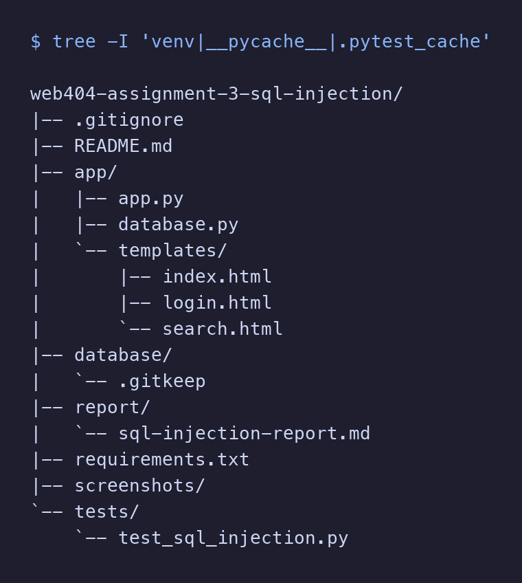
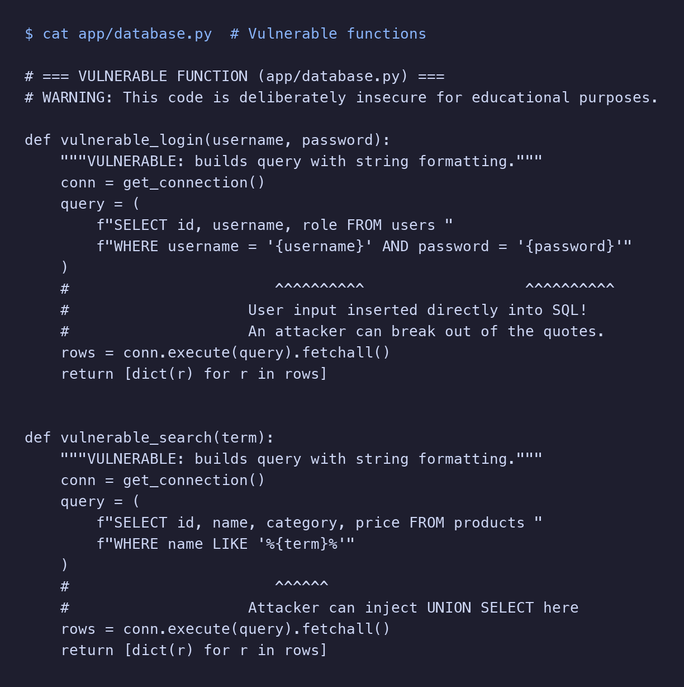
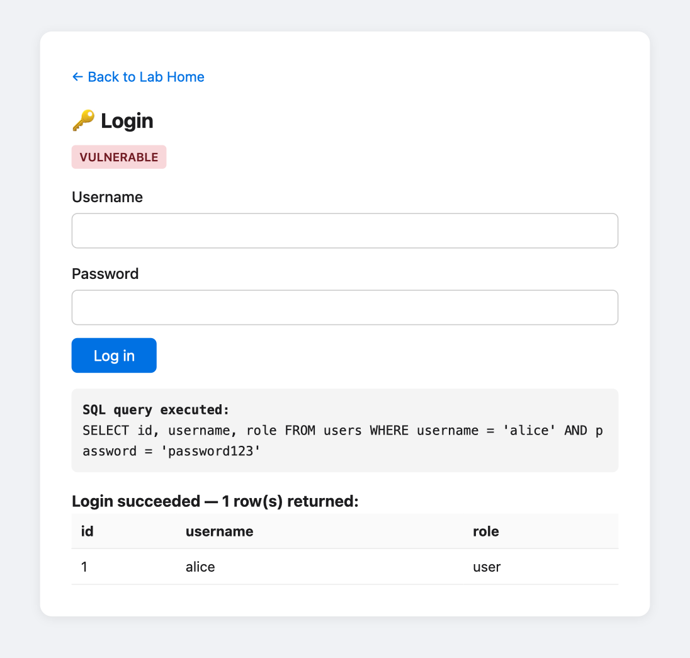
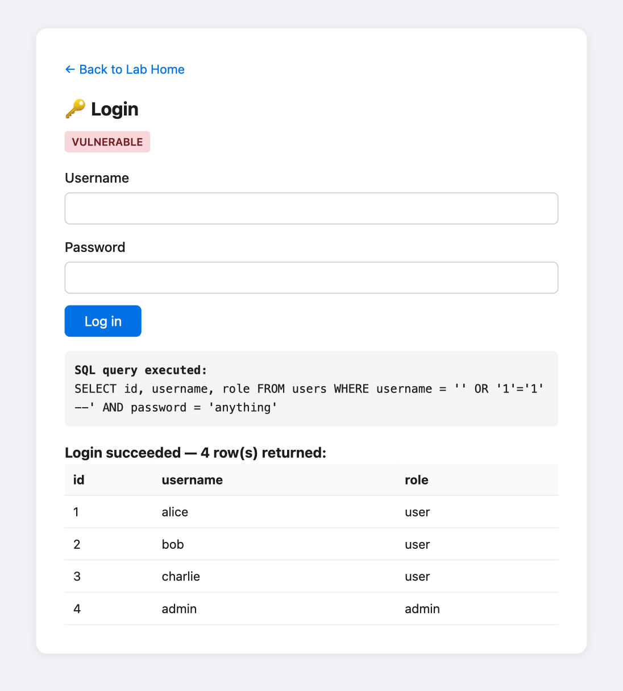
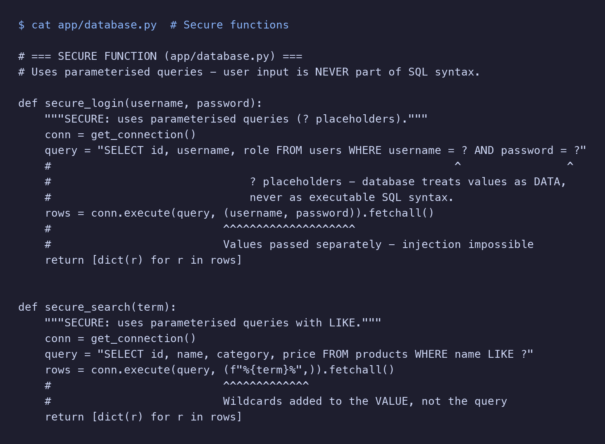
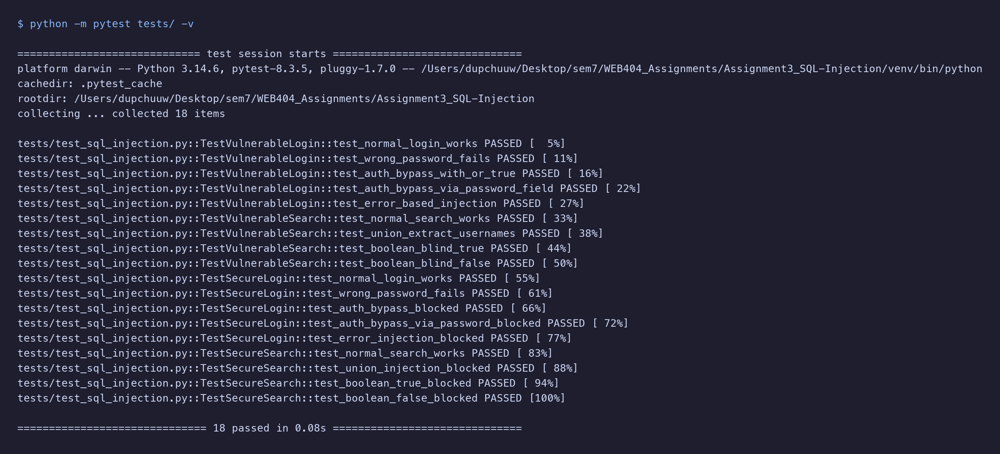

# WEB404 Assignment 3 – SQL Injection Lab Report

**Student:** Dupchu Wangmo
**Environment:** macOS (Darwin 27.0), Python 3.14

## 1. Aim and Objectives

**Aim:** Set up a deliberately vulnerable web application and perform various types of SQL injection attacks in an isolated local lab, then implement and verify secure defences.

**Objectives:**

- Build a Flask + SQLite web application with both vulnerable and secure code paths.
- Demonstrate five categories of SQL injection attack using fictional data.
- Implement parameterised queries and input validation to prevent injection.
- Write automated tests that prove the vulnerable code is exploitable and the secure code resists the same payloads.
- Document findings in a structured report with real evidence from the lab environment.


## 2. Introduction

SQL injection (SQLi) is one of the oldest and most damaging web application vulnerabilities. It occurs when user-supplied input is inserted directly into an SQL query through string concatenation rather than being passed as a separate parameter. An attacker who controls part of the query can bypass authentication, extract data from other tables, modify records, or even execute operating-system commands on some database engines.

Despite being well understood, SQL injection remains in the OWASP Top 10 because developers continue to build queries with string formatting. This assignment creates a controlled lab to experience the attack first-hand and to understand exactly why parameterised queries are the primary defence.

All attacks in this lab target a local SQLite database populated with fictional data. No real systems, external servers, or personal data are involved.

## 3. SQL Injection Theory and Impact

### How SQL Injection Works

A web application typically receives user input and inserts it into an SQL query. If the application uses string concatenation, the user's input becomes part of the SQL syntax itself:

```python
# VULNERABLE – string concatenation
query = f"SELECT * FROM users WHERE username = '{username}' AND password = '{password}'"
```

If an attacker enters `' OR '1'='1' --` as the username, the query becomes:

```sql
SELECT * FROM users WHERE username = '' OR '1'='1' --' AND password = '...'
```

The `OR '1'='1'` clause is always true, and the `--` comments out the remaining password check. The query returns all users, bypassing authentication entirely.

### Types of SQL Injection

| Type | Technique | What It Achieves |
|------|-----------|-----------------|
| Basic / in-band | Inject `OR 1=1` into a WHERE clause | Bypass authentication or extract all rows |
| UNION-based | Append `UNION SELECT` to pull data from other tables | Read data from tables the query was not designed to access |
| Error-based | Inject syntax errors to extract info from error messages | Fingerprint the database engine and schema |
| Boolean-based blind | Inject true/false conditions and observe result changes | Extract data one bit at a time when no direct output is shown |
| Time-based blind | Inject `SLEEP()` and measure response time | Same as boolean-based but for pages with identical output |

### Real-World Impact

SQL injection can lead to complete database compromise, exposure of user credentials, financial data theft, unauthorised administrative access, data modification or deletion, and in some configurations, execution of operating-system commands on the database server.


## 4. Lab Setup and Database Design

### Technology Stack

| Component | Technology |
|-----------|-----------|
| Language | Python 3.14 |
| Framework | Flask 3.1.1 |
| Database | SQLite (built-in) |
| CSRF protection | Flask-WTF 1.2.2 |
| Testing | pytest 8.3.5 |
| OS | macOS (Darwin 27.0) |

### Database Schema

**users** — fictional login credentials:

| id | username | password | role |
|----|----------|----------|------|
| 1 | alice | password123 | user |
| 2 | bob | letmein | user |
| 3 | charlie | qwerty | user |
| 4 | admin | supersecret | admin |

**products** — fictional product catalogue:

| id | name | category | price |
|----|------|----------|-------|
| 1 | Wireless Mouse | Electronics | 29.99 |
| 2 | Mechanical Keyboard | Electronics | 89.50 |
| 3 | Desk Lamp | Office | 34.00 |
| 4 | USB-C Hub | Electronics | 45.00 |
| 5 | Notebook A5 | Stationery | 5.99 |
| 6 | Ergonomic Chair | Office | 299.00 |

Passwords are stored in plaintext intentionally — this is an isolated lab, not a production system.

### Project Structure




## 5. Vulnerable Implementation

The vulnerable functions in `database.py` build SQL queries using Python f-strings, inserting user input directly into the query text:

```python
def vulnerable_login(username, password):
    query = f"SELECT id, username, role FROM users WHERE username = '{username}' AND password = '{password}'"
    rows = conn.execute(query).fetchall()
```

The user-supplied values are placed inside single quotes with no escaping or parameterisation. Any input containing a single quote breaks out of the string literal and becomes executable SQL.




## 6. Attack Test Cases and Observed Results

### Attack 1 — Basic Authentication Bypass

**Payload (username):** `' OR '1'='1' --`
**Password:** anything

**Interpolated query:**
```sql
SELECT id, username, role FROM users WHERE username = '' OR '1'='1' --' AND password = 'anything'
```

**Result:** All 4 users returned. Authentication completely bypassed.

### Attack 2 — Password Field Injection

**Username:** admin | **Password:** `' OR '1'='1`

**Result:** The admin account and all other users returned without knowing the password.

### Attack 3 — UNION-Based Data Extraction

**Search payload:** `' UNION SELECT id, username, password, role FROM users --`

**Result:** The search results displayed all usernames and plaintext passwords from the users table alongside the product data.

### Attack 4 — Boolean-Based Blind Injection

**True payload:** `' OR 1=1 --` → 6 products returned
**False payload:** `' AND 1=2 --` → 0 products returned

By observing the difference, an attacker can ask yes/no questions and extract data character by character.

### Attack 5 — Error-Based Injection

**Payload:** `'` (a single quote)

**Result:** SQLite returned an OperationalError, confirming the injection point and revealing the database engine.






## 7. Secure Implementation

The secure functions use parameterised queries with `?` placeholders:

```python
def secure_login(username, password):
    query = "SELECT id, username, role FROM users WHERE username = ? AND password = ?"
    rows = conn.execute(query, (username, password)).fetchall()
```

The database driver treats each `?` parameter as a literal value, not as SQL syntax. Even if the username contains `' OR '1'='1' --`, the database searches for a user whose username is literally that string — which does not exist.

Additional defences implemented:
- **Input validation:** Secure login rejects usernames not matching `^[a-zA-Z0-9_]{1,50}$`
- **Length limiting:** Search terms truncated to 100 characters
- **Safe error handling:** Errors logged server-side, never exposed to users
- **CSRF protection:** All forms include Flask-WTF CSRF tokens
- **Separation of concerns:** Database logic in `database.py`, routes in `app.py`




## 8. Comparison of Vulnerable and Secure Behaviour

| Attack Payload | Vulnerable Result | Secure Result |
|---------------|-------------------|---------------|
| `' OR '1'='1' --` (login) | All 4 users returned — bypass succeeds | 0 rows — login fails |
| `admin` / `' OR '1'='1` | Admin row returned — bypass succeeds | 0 rows — login fails |
| `'` (login) | SQL error leaked | 0 rows — no error exposed |
| UNION SELECT from users (search) | Usernames and passwords exposed | 0 rows — treated as literal text |
| `' OR 1=1 --` (search) | All 6 products returned | 0 rows — no information leakage |
| `Mouse` (search) | 1 product returned (normal) | 1 product returned (normal) |

Legitimate users experience no difference between implementations. Only malicious payloads are affected.


## 9. Automated Test Results

The test suite contains 18 tests in two parts:

**Part A** (9 tests): Prove injection succeeds with string concatenation.
**Part B** (9 tests): Prove parameterised queries block every attack.





## 10. Mitigation Recommendations

1. **Always use parameterised queries.** Pass user input as parameters (`?` in SQLite, `%s` in MySQL, `$1` in PostgreSQL) rather than concatenating it into the query string.
2. **Use an ORM where possible.** SQLAlchemy generates parameterised queries automatically, reducing developer error.
3. **Validate input server-side.** Reject input that does not match expected patterns (e.g., alphanumeric usernames).
4. **Apply least-privilege database access.** The application's database account should have only the permissions it needs.
5. **Handle errors safely.** Never display raw database error messages to users.
6. **Use Web Application Firewalls.** A WAF can detect common injection patterns as an additional layer.
7. **Conduct regular security testing.** Use tools like SQLMap and Burp Suite alongside manual code review.
8. **Keep dependencies updated.** Database drivers and frameworks should be at their latest stable versions.

## 12. Limitations

- **SQLite only.** SQLite does not support multi-statement execution by default, so stacked queries and `SLEEP()`-based time-blind injection cannot be demonstrated.
- **Plaintext passwords.** Used for lab simplicity. Production systems must use bcrypt or argon2.
- **No WAF or IDS.** The lab does not include a Web Application Firewall or Intrusion Detection System.
- **Single-user lab.** Does not demonstrate privilege escalation across roles.
- **No HTTPS.** The lab runs over plain HTTP. Production requires TLS.

## 13. Conclusion

This assignment demonstrates through hands-on experimentation that SQL injection is both easy to exploit and easy to prevent. The vulnerable implementation was successfully exploited using five techniques: basic authentication bypass, password-field injection, UNION-based data extraction, boolean-based blind injection, and error-based information disclosure.

The secure implementation resisted every attack without any change in functionality for legitimate users. The automated test suite of 18 tests confirms this by running identical payloads against both implementations and asserting opposite outcomes.

The key takeaway is that **parameterised queries are the primary and most effective defence against SQL injection**. They separate query structure from data values, making it impossible for user input to alter the intended SQL syntax.


## 14. References

1. OWASP Foundation. "SQL Injection." https://owasp.org/www-community/attacks/SQL_Injection
2. OWASP Foundation. "SQL Injection Prevention Cheat Sheet." https://cheatsheetseries.owasp.org/cheatsheets/SQL_Injection_Prevention_Cheat_Sheet.html
3. CWE-89: SQL Injection. MITRE. https://cwe.mitre.org/data/definitions/89.html
4. PortSwigger. "SQL Injection." https://portswigger.net/web-security/sql-injection
5. Python Documentation. "sqlite3." https://docs.python.org/3/library/sqlite3.html
6. Flask Documentation. https://flask.palletsprojects.com/en/stable/
7. Flask-WTF Documentation. https://flask-wtf.readthedocs.io/en/stable/csrf.html
8. Justin Clarke. *SQL Injection Attacks and Defense.* 2nd ed. Syngress, 2012.
