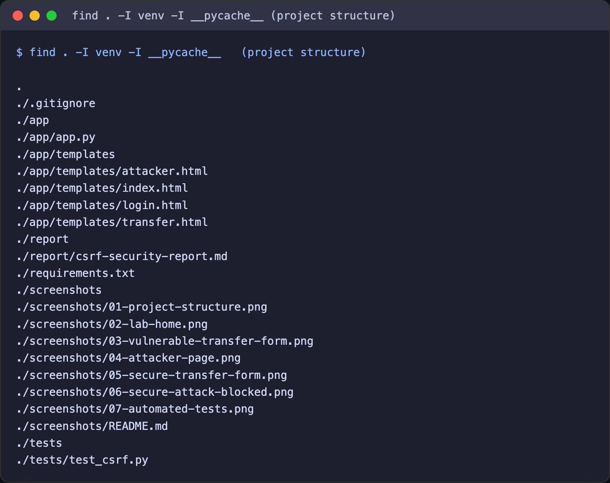
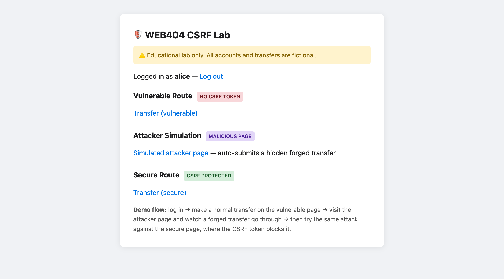
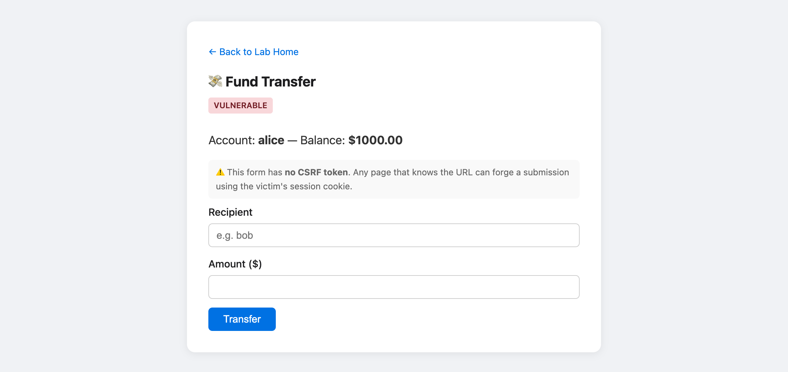
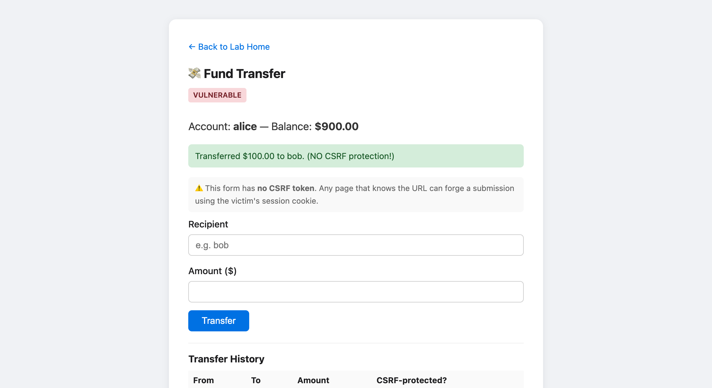
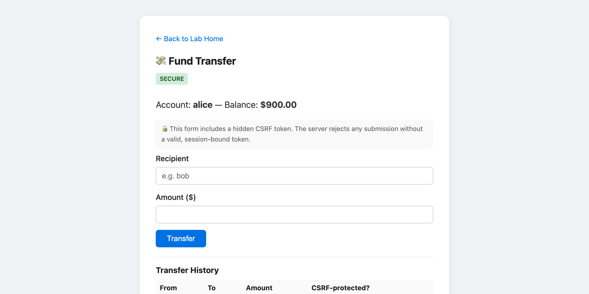
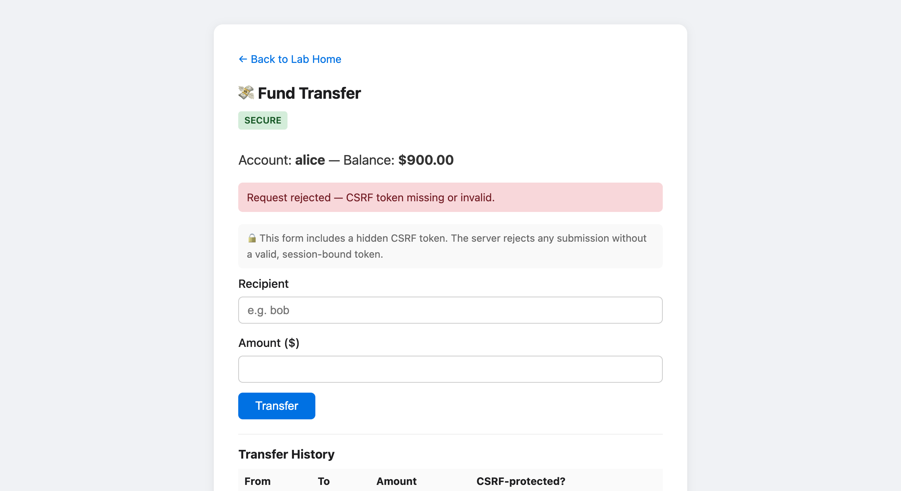
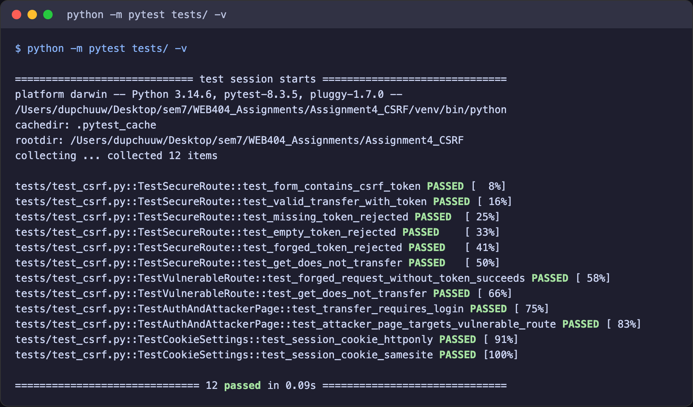

# WEB404 Assignment 4 – CSRF Lab Report

**Student:** Dupchu Wangmo
**Environment:** macOS (Darwin 27.0), Python 3.14

## 1. Aim and Objectives

**Aim:** Build a web form that is vulnerable to Cross-Site Request Forgery (CSRF), demonstrate a working attack against it, then implement CSRF tokens and verify that the attack is blocked.

**Objectives:**

- Build a Flask application with a deliberately vulnerable money-transfer form and a secure equivalent.
- Demonstrate a proof-of-concept CSRF attack using a simulated malicious page that auto-submits a forged transfer.
- Implement server-validated CSRF tokens using Flask-WTF, backed by `SameSite` and `HttpOnly` cookie flags.
- Write automated tests that prove the secure route rejects forged, missing, and tampered tokens while the vulnerable route accepts a token-less request.
- Document findings in a structured report with real evidence from the lab environment.


## 2. Introduction

Cross-Site Request Forgery (CSRF) forces an authenticated user's browser to send a request the user never intended. The attacker hosts a page containing a hidden form (or image, or script) that targets the victim application. When a logged-in victim loads the attacker's page, their browser **automatically attaches the session cookie** to the forged request. The server sees a valid session and processes the request as if the user had deliberately submitted it.

CSRF is dangerous precisely because it needs no code execution on the target site and no knowledge of the victim's password — only that the victim is logged in and visits a malicious page. It has long appeared in the OWASP Top 10 and is catalogued as CWE-352.

All actions in this lab target a local Flask application with three fictional accounts and in-memory balances. No real money, external services, or personal data are involved.


## 3. CSRF Theory and Impact

### How CSRF Works

A state-changing endpoint such as a fund transfer typically trusts the session cookie alone:

```html
<!-- The application's own transfer form -->
<form method="POST" action="/transfer">
    <input name="recipient" value="bob">
    <input name="amount" value="100">
</form>
```

An attacker copies that form onto their own page, fills in hidden values, and makes it submit automatically:

```html
<!-- On the attacker's page -->
<form id="f" method="POST" action="https://bank.example/transfer">
    <input type="hidden" name="recipient" value="attacker">
    <input type="hidden" name="amount" value="5000">
</form>
<script>document.getElementById('f').submit();</script>
```

Because the request goes to `bank.example`, the browser attaches that site's session cookie. The server cannot tell this forged request apart from a genuine one — unless the request carries a secret the attacker's page cannot know.

### Why Authentication Alone Does Not Prevent CSRF

Authentication answers *who* the user is; it does not answer *whether the user intended this request*. The session cookie proves identity and is attached automatically by the browser to every request for that origin, including forged ones. A CSRF token closes this gap: it is a secret, per-session value embedded in the legitimate form that the attacker's cross-origin page cannot read (Same-Origin Policy) or guess.

### How CSRF Differs from XSS

| Aspect | CSRF | XSS |
|--------|------|-----|
| Where code runs | On the attacker's site (external) | Inside the target site (injected) |
| What is exploited | The browser's automatic cookie attachment | The application's failure to encode output |
| What the attacker needs | The victim to be logged in and visit a page | A way to inject script into the target page |
| What the attacker can read | Nothing from the target (blind write) | Page content, tokens, cookies (if not HttpOnly) |
| Primary defence | CSRF tokens, SameSite cookies | Output encoding, Content Security Policy |

### Common CSRF Delivery Vectors

| Vector | Technique | Note |
|--------|-----------|------|
| Auto-submitting form | Hidden `<form>` + JavaScript `submit()` | Works for POST; used in this lab |
| Image / link GET | `` | Only if the app allows state change on GET |
| `fetch` / `XMLHttpRequest` | Scripted cross-origin request | Blocked from reading the response by CORS, but the request still fires |

### Real-World Impact

A successful CSRF attack lets an attacker perform any state-changing action in the victim's name: transferring funds, changing the account email or password, making purchases, changing privacy settings, or — against an admin — creating new privileged users. The victim sees nothing; the action simply happens under their session.


## 4. Lab Setup and Application Design

### Technology Stack

| Component | Technology |
|-----------|-----------|
| Language | Python 3.14 |
| Framework | Flask 3.1.1 |
| CSRF protection | Flask-WTF 1.2.2 (`CSRFProtect`) |
| Testing | pytest 8.3.5 |
| OS | macOS (Darwin 27.0) |

### Accounts

The application simulates fund transfers between three fictional accounts held in memory:

| Account | Starting Balance | Password |
|---------|-----------------|----------|
| alice | $1,000.00 | password123 |
| bob | $500.00 | letmein |
| admin | $5,000.00 | supersecret |

Passwords are stored in plaintext intentionally — this is an isolated lab, not a production system.

### Routes

| Route | Method | Purpose |
|-------|--------|---------|
| `/` | GET | Lab home page |
| `/login`, `/logout` | GET/POST | Session-based authentication |
| `/vulnerable/transfer` | GET/POST | Transfer form with **no** CSRF protection (`@csrf.exempt`) |
| `/attacker` | GET | Simulated malicious page that auto-submits a forged transfer |
| `/secure/transfer` | GET/POST | Transfer form with CSRF token validated by Flask-WTF |

### Project Structure






## 5. Vulnerable Implementation and the Attack

### The Vulnerable Form

The `/vulnerable/transfer` route is explicitly exempted from CSRF checking so the flaw can be demonstrated:

```python
@app.route("/vulnerable/transfer", methods=["GET", "POST"])
@csrf.exempt
@login_required
def vuln_transfer():
    user = session["user"]
    if request.method == "POST":
        msg, cat = do_transfer(user, protected=False)
        ...
```

The form contains only `recipient` and `amount` — no token. Any page that can POST to this URL can trigger a transfer using the victim's session cookie.



### The Attacker Page

The `/attacker` route serves a page disguised as a prize notification. Hidden inside it is a form that auto-submits to the vulnerable endpoint:

```html
<form class="hidden-form" id="csrf-form" method="POST"
      action="http://127.0.0.1:5002/vulnerable/transfer">
    <input type="hidden" name="recipient" value="bob">
    <input type="hidden" name="amount" value="100">
</form>
<script>
    setTimeout(function () {
        document.getElementById('csrf-form').submit();
    }, 1000);
</script>
```

When a logged-in user opens this page, the form submits after one second. The browser attaches the user's session cookie, and the vulnerable endpoint processes the transfer. The victim loses $100 to `bob` without ever intending to.

This was confirmed against the running application: a POST to `/vulnerable/transfer` carrying only the session cookie and **no token** succeeded, logging:

```
WARNING in app: VULNERABLE transfer by alice: Transferred $100.00 to bob.
```



> **Note on same-origin hosting.** For convenience the attacker page is served from the same origin (`127.0.0.1:5002`) as the application, so the demonstration isolates the role of the CSRF **token**. In a real attack the page would be on a different domain, where the `SameSite=Lax` cookie flag (section 7) would provide an additional browser-enforced layer of defence.


## 6. Secure Implementation

### CSRF Tokens with Flask-WTF

`CSRFProtect(app)` enables token validation on every state-changing request (POST/PUT/PATCH/DELETE) by default. The secure form embeds a unique, session-bound token in a hidden field:

```html
<input type="hidden" name="csrf_token" value="{{ csrf_token() }}">
```

On each POST, Flask-WTF checks that the `csrf_token` field is present, matches the token stored in the server-side session, and has not expired. If any check fails it raises `CSRFError` (HTTP 400) **before** the view runs. The application catches this and shows a clear rejection:

```python
@app.errorhandler(CSRFError)
def handle_csrf_error(e):
    app.logger.warning("CSRF validation failed: %s", e.description)
    flash("Request rejected — CSRF token missing or invalid.", "danger")
    ...
```

The attacker's page cannot supply a valid token because it cannot read the victim application's HTML across origins (Same-Origin Policy), and the token is tied to the victim's session, making it infeasible to guess.



### Defence-in-Depth: Cookie Flags

```python
app.config["SESSION_COOKIE_SAMESITE"] = "Lax"
app.config["SESSION_COOKIE_HTTPONLY"] = True
```

- **`SameSite=Lax`** — the browser does not attach the session cookie to cross-site POST requests, blocking cross-origin CSRF even before the token check runs.
- **`HttpOnly`** — JavaScript cannot read the session cookie, limiting the damage of any XSS flaw that might otherwise be chained with CSRF.

Against the running application, the same forged POST sent to `/secure/transfer` with no token was rejected and performed no transfer:

```
WARNING in app: CSRF validation failed: The CSRF token is missing.
```

A legitimate POST carrying a valid token succeeded normally:

```
INFO in app: SECURE transfer by alice: Transferred $25.00 to bob.
```




## 7. Comparison of Vulnerable and Secure Behaviour

| Request | Vulnerable Route | Secure Route |
|---------|------------------|--------------|
| Forged POST, **no** `csrf_token` (session cookie only) | Transfer succeeds — attack works | HTTP 400, rejected — no transfer |
| POST with **empty** `csrf_token` | Transfer succeeds | Rejected — no transfer |
| POST with **tampered/fake** token | Transfer succeeds | Rejected — no transfer |
| POST with **valid** token | Transfer succeeds | Transfer succeeds |
| Legitimate user's own transfer | Works | Works (token added automatically by the form) |

Legitimate users experience no difference between the two implementations. Only forged requests are affected.


## 8. Automated Test Results

The suite contains **12 tests** in two parts:

- **Part A — Secure route (6 tests):** form carries a token; valid token succeeds; missing, empty, and tampered tokens are each rejected; GET performs no transfer.
- **Part B — Vulnerable route (2 tests):** a token-less forged POST succeeds (proving the attack), and GET performs no transfer.
- **Supporting (4 tests):** transfer requires login, the attacker page targets the vulnerable route, and the session cookie is `HttpOnly` with `SameSite` set to `Lax`.

### How to Run

```bash
cd Assignment4_CSRF
source venv/bin/activate
python -m pytest tests/ -v
```

### Actual Results

```
============================= test session starts ==============================
platform darwin -- Python 3.14.6, pytest-8.3.5, pluggy-1.7.0
collected 12 items

tests/test_csrf.py::TestSecureRoute::test_form_contains_csrf_token PASSED [  8%]
tests/test_csrf.py::TestSecureRoute::test_valid_transfer_with_token PASSED [ 16%]
tests/test_csrf.py::TestSecureRoute::test_missing_token_rejected PASSED  [ 25%]
tests/test_csrf.py::TestSecureRoute::test_empty_token_rejected PASSED    [ 33%]
tests/test_csrf.py::TestSecureRoute::test_forged_token_rejected PASSED   [ 41%]
tests/test_csrf.py::TestSecureRoute::test_get_does_not_transfer PASSED   [ 50%]
tests/test_csrf.py::TestVulnerableRoute::test_forged_request_without_token_succeeds PASSED [ 58%]
tests/test_csrf.py::TestVulnerableRoute::test_get_does_not_transfer PASSED [ 66%]
tests/test_csrf.py::TestAuthAndAttackerPage::test_transfer_requires_login PASSED [ 75%]
tests/test_csrf.py::TestAuthAndAttackerPage::test_attacker_page_targets_vulnerable_route PASSED [ 83%]
tests/test_csrf.py::TestCookieSettings::test_session_cookie_httponly PASSED [ 91%]
tests/test_csrf.py::TestCookieSettings::test_session_cookie_samesite PASSED [100%]

============================== 12 passed in 0.19s ==============================
```



### Limitations of Test-Client Simulation

Flask's test client sends requests directly to the WSGI application without a real browser, so it verifies the **server-side token check** — the primary defence. It does not exercise browser-enforced behaviour such as `SameSite` cookie handling or `Origin`/`Referer` checks. Full end-to-end verification of those layers would require a real browser driven by Selenium, or an intercepting proxy such as Burp Suite. The browser-level behaviour in this lab was instead demonstrated manually (sections 5–6).


## 9. Mitigation Recommendations

1. **Use synchronizer CSRF tokens on every state-changing request.** Never rely on the session cookie alone to prove intent.
2. **Set `SameSite=Lax` (or `Strict`) on session cookies.** This blocks cross-site cookie attachment at the browser level as a second layer.
3. **Mark session cookies `HttpOnly` and `Secure`.** Prevents script access and ensures cookies are only sent over HTTPS.
4. **Only change state on POST/PUT/PATCH/DELETE — never on GET.** This stops the simplest ``/link-based CSRF.
5. **Validate the `Origin`/`Referer` header** on sensitive requests as an additional check.
6. **Re-authenticate or require re-entry of credentials** for high-value actions (e.g. changing a password or email).
7. **Use a framework's built-in CSRF protection** (Flask-WTF, Django, Rails) rather than hand-rolling token logic.
8. **Keep dependencies updated** so cookie and CSRF defaults track current browser standards.


## 10. Limitations

- **Same-origin attacker page.** The attacker page is hosted on the application's own origin for lab convenience, so it isolates the token's role; a true cross-origin attack would also be affected by `SameSite`.
- **In-memory state.** Balances reset when the server restarts; there is no database.
- **Plaintext passwords.** Used for lab simplicity. Production systems must use bcrypt or argon2.
- **No HTTPS.** The lab runs over plain HTTP, so the `Secure` cookie flag is not exercised; production requires TLS.
- **Test client is not a browser.** `SameSite`/`Origin` enforcement is verified manually, not in the automated suite.


## 11. Conclusion

This assignment demonstrates, hands-on, that CSRF is both easy to exploit and straightforward to prevent. The vulnerable transfer endpoint was successfully attacked by a hidden, auto-submitting form that rode the victim's authenticated session — no password and no script execution on the target were needed.

The secure endpoint resisted the identical forged request because Flask-WTF validated a secret, session-bound token the attacker's page could not read or guess, with `SameSite=Lax` and `HttpOnly` cookies as additional browser-enforced layers. A suite of 12 automated tests confirms that valid tokens succeed while missing, empty, and tampered tokens are all rejected, and that the unprotected route accepts the forgery.

The key takeaway is that **authentication proves identity, but only a CSRF token proves intent** — separating the two is the primary and most effective defence against Cross-Site Request Forgery.


## 12. References

1. OWASP Foundation. "Cross Site Request Forgery (CSRF)." https://owasp.org/www-community/attacks/csrf
2. OWASP Foundation. "Cross-Site Request Forgery Prevention Cheat Sheet." https://cheatsheetseries.owasp.org/cheatsheets/Cross-Site_Request_Forgery_Prevention_Cheat_Sheet.html
3. CWE-352: Cross-Site Request Forgery (CSRF). MITRE. https://cwe.mitre.org/data/definitions/352.html
4. PortSwigger. "Cross-site request forgery (CSRF)." https://portswigger.net/web-security/csrf
5. MDN Web Docs. "SameSite cookies." https://developer.mozilla.org/en-US/docs/Web/HTTP/Headers/Set-Cookie/SameSite
6. Flask-WTF Documentation. "CSRF Protection." https://flask-wtf.readthedocs.io/en/stable/csrf.html
7. Flask Documentation. https://flask.palletsprojects.com/en/stable/
