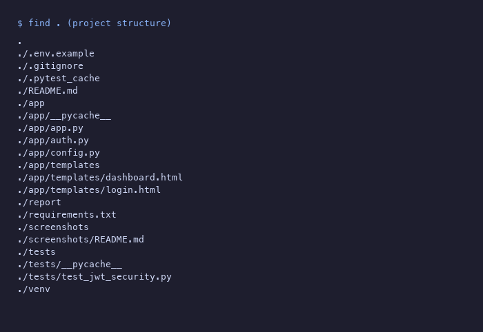
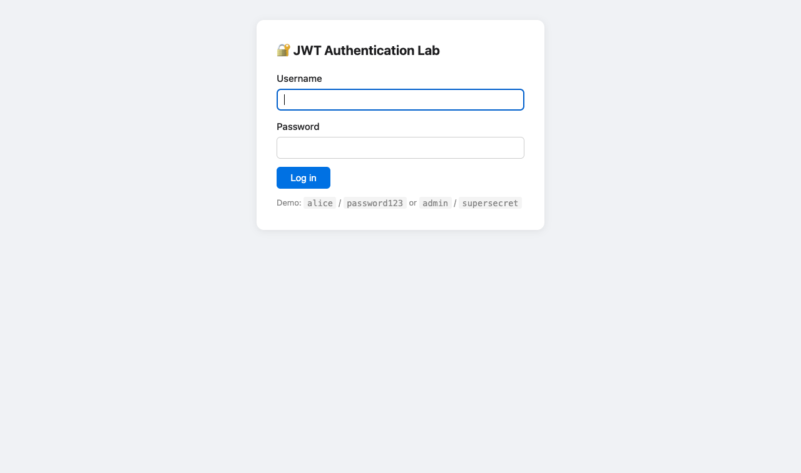
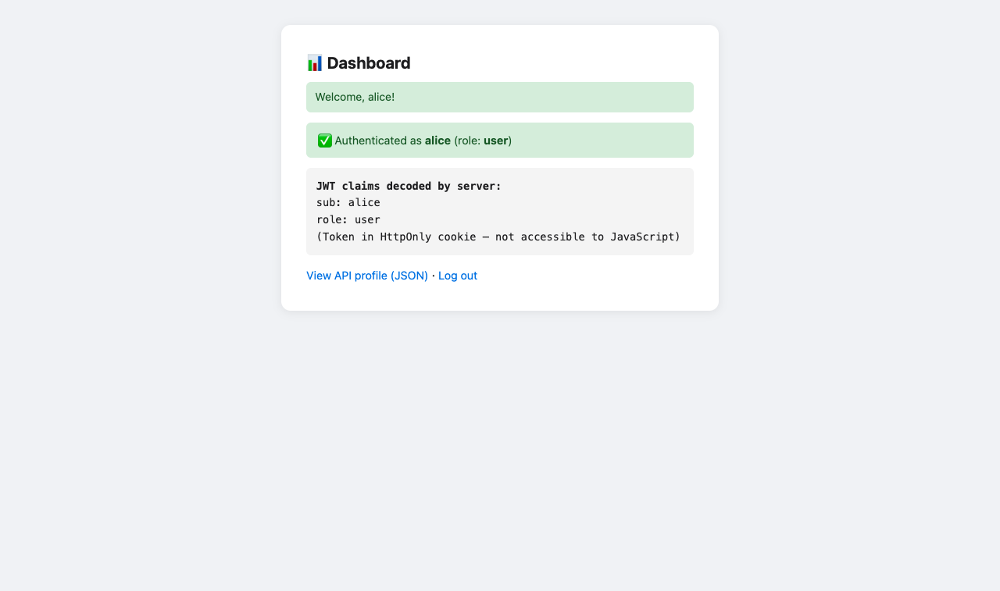
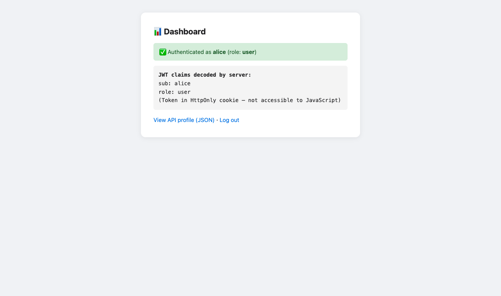
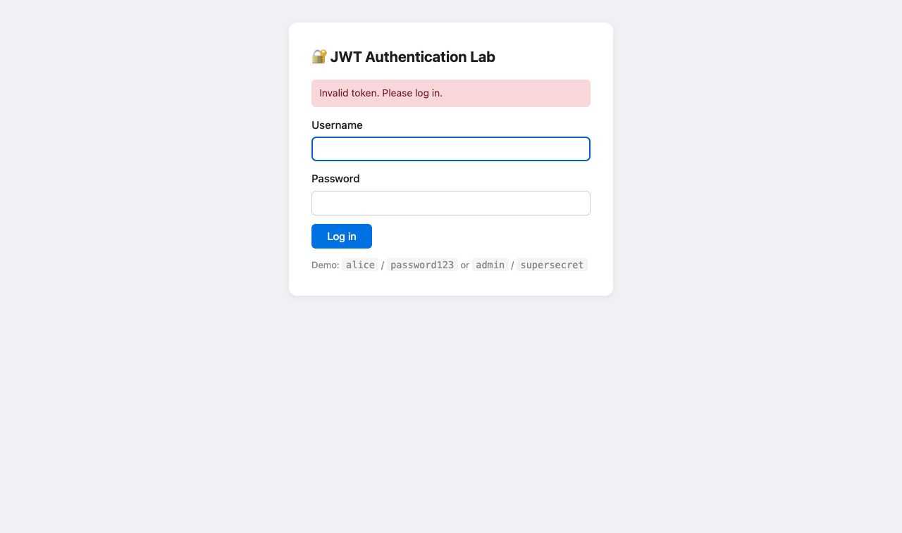
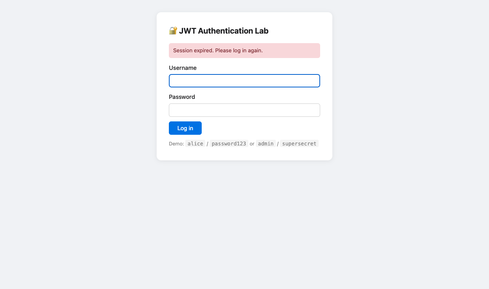
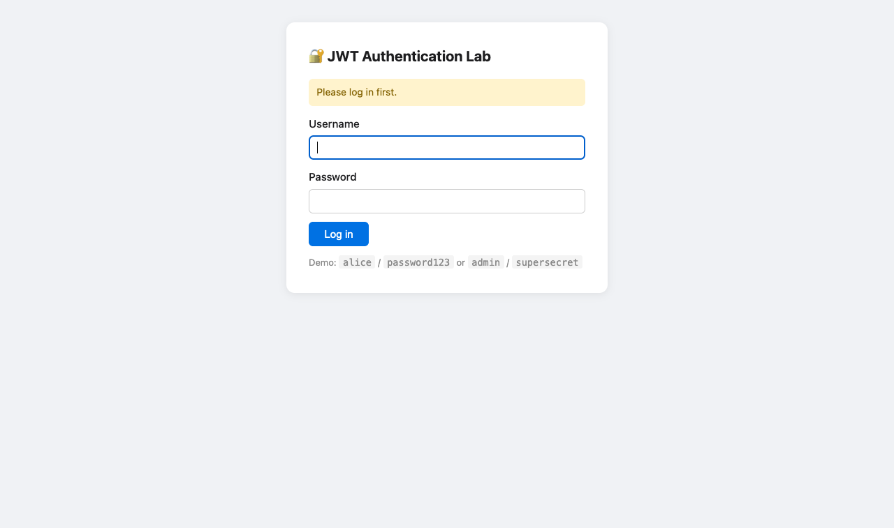
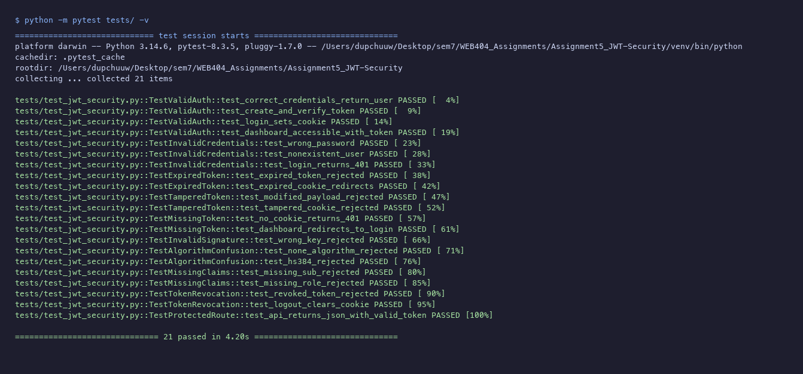

# WEB404 Assignment 5 — JWT Security Report

**Student:** Dupchu Wangmo
**Environment:** macOS (MacBook Air)  


## 1. Aim and Objectives

**Aim:** Develop a JWT-based authentication system, demonstrate common JWT attacks, and implement secure JWT handling.

**Objectives:**
- Build a Flask application that issues and validates JWTs for authentication.
- Demonstrate seven categories of JWT vulnerability in controlled tests.
- Implement secure token handling with pinned algorithms, expiry, claim validation, and revocation.
- Write 21 automated tests proving both the attacks and the defences.


## 2. Introduction

JSON Web Tokens (JWTs) are a compact, URL-safe way to represent authentication claims between two parties. A server issues a signed token after verifying credentials; the client includes it in subsequent requests to prove identity without re-authenticating. JWTs are widely used in APIs, single-page applications, and microservice architectures.

However, JWTs introduce specific security risks if handled carelessly: algorithm confusion, missing signature verification, weak secrets, and the inability to revoke tokens after issuance. This assignment builds a lab that demonstrates these risks and implements the defences recommended by OWASP and RFC 7519.


## 3. JWT Structure: Header, Payload, and Signature

A JWT has three Base64URL-encoded parts separated by dots: `header.payload.signature`

**Header** — specifies the token type and signing algorithm:
```json
{"alg": "HS256", "typ": "JWT"}
```

**Payload** — contains claims (statements about the user):
```json
{"sub": "alice", "role": "user", "iat": 1729872000, "exp": 1729872900}
```

**Signature** — created by signing the encoded header and payload with a secret:
```
HMAC-SHA256(base64url(header) + "." + base64url(payload), secret)
```

The server verifies the signature before trusting any claims. If the payload is modified without the secret, the signature will not match and the token is rejected.

## 4. Application Architecture

```
Assignment5_JWT-Security/
├── app/
│   ├── app.py          # Flask routes, jwt_required decorator
│   ├── auth.py         # Token creation, verification, revocation
│   ├── config.py       # Secrets from environment variables
│   └── templates/
│       ├── login.html
│       └── dashboard.html
├── tests/
│   └── test_jwt_security.py   # 21 automated tests
├── screenshots/
├── report/
│   └── jwt-security-report.md
├── .env.example
├── requirements.txt
└── README.md
```



## 5. Authentication Implementation

### Login Flow
1. User submits credentials via POST `/login`.
2. Server verifies username/password against fictional accounts.
3. On success, `create_token()` generates a signed JWT with `sub`, `role`, `iat`, and `exp` claims.
4. The token is set as an HttpOnly, SameSite=Lax cookie.
5. Subsequent requests to protected routes (`/dashboard`, `/api/profile`) are validated by the `jwt_required` decorator.

### Token Storage: Cookies vs localStorage

| Approach | Pros | Cons |
|----------|------|------|
| HttpOnly cookie (used here) | JavaScript cannot read it (mitigates XSS theft) | Requires CSRF protection; sent automatically on every request |
| localStorage | Immune to CSRF (must be explicitly attached) | Vulnerable to XSS — any injected script can steal the token |

This lab uses cookies with HttpOnly, SameSite=Lax, and Flask-WTF CSRF protection on form routes.

### Secret Management
Signing secrets are loaded from environment variables (`JWT_SECRET`), never hardcoded. The `.env.example` file documents required variables without containing real values.






## 6. Vulnerability Demonstrations

### 6.1 Tampered Payload
An attacker decodes the payload, changes `role` from `user` to `admin`, and re-encodes it — but cannot re-sign it without the secret. The signature no longer matches, and `verify_token()` raises `InvalidSignatureError`.

### 6.2 Expired Token
A token created with a 1-second expiry is used after 2 seconds. PyJWT raises `ExpiredSignatureError`.

### 6.3 Invalid Signature
A token signed with `attacker-secret` instead of the server's secret is rejected with `InvalidSignatureError`.

### 6.4 Algorithm Confusion / alg:none
A hand-crafted token with `"alg": "none"` and no signature is rejected because `verify_token()` pins the algorithm to `["HS256"]` — it never trusts the token's own `alg` header. A token signed with HS384 is also rejected.

### 6.5 Missing Required Claims
Tokens missing `sub` or `role` are rejected with `MissingRequiredClaimError` because `verify_token()` requires both.

### 6.6 Weak Secret Risks
The dev secret `dev-secret-change-in-production` is deliberately weak. An attacker with a leaked or guessable secret can forge valid tokens. The `.env.example` instructs users to set a strong (32+ character) random secret in production.

### 6.7 Token Replay and Revocation
After `revoke_token()` adds a token to the blacklist, `verify_token()` rejects it even though the signature is still valid. This is the only way to "invalidate" a JWT before expiry — the limitation is that the blacklist is in-memory and lost on restart.






## 7. Secure Implementation and Mitigation

| Attack | Defence |
|--------|---------|
| Tampered payload | HMAC signature verification rejects any modification |
| Expired token | `exp` claim checked; 15-minute default |
| Wrong signing key | Signature mismatch raises `InvalidSignatureError` |
| alg:none / alg confusion | Algorithm pinned to `["HS256"]` — token's `alg` header is ignored |
| Missing claims | `require: ["sub","exp","iat","role"]` enforced |
| Weak secret | Environment variable with .env.example guidance |
| Token replay after logout | In-memory blacklist checked before verification |
| XSS token theft | HttpOnly cookie — JS cannot read it |
| CSRF via cookie | SameSite=Lax + Flask-WTF CSRF tokens on forms |

## 8. Automated Testing and Actual Results

21 tests across 10 categories. Executed with `python -m pytest tests/ -v` on Python 3.14.6:




## 9. Token Storage and Lifecycle

### Lifecycle
1. **Issuance:** On successful login, a 15-minute token is created.
2. **Validation:** Every protected request verifies signature, expiry, and required claims.
3. **Revocation:** Logout adds the token to an in-memory blacklist.
4. **Expiry:** After 15 minutes, the token is rejected regardless of blacklist status.

### CSRF Considerations
Because the JWT is in a cookie, the browser attaches it to every request — including forged ones. This lab mitigates CSRF with:
- `SameSite=Lax` cookies (browser blocks cross-site POST)
- Flask-WTF CSRF tokens on all form routes
- The API endpoint (`/api/profile`) is read-only (GET), reducing CSRF risk


## 10. Limitations

- **In-memory blacklist.** Token revocations are lost on restart. Production would use Redis.
- **Plaintext passwords.** Lab only — production must use bcrypt/argon2.
- **No refresh tokens.** A production system would issue short-lived access tokens with longer-lived refresh tokens.
- **Single signing key.** Key rotation is not implemented.
- **No HTTPS.** The Secure cookie flag is not set because the lab runs over HTTP.
- **No rate limiting.** Login brute-force is not throttled.


## 11. Conclusion

This assignment demonstrates that JWTs are only as secure as their implementation. The 21 automated tests prove that tampered payloads, expired tokens, wrong signatures, algorithm confusion, missing claims, and revoked tokens are all correctly rejected by the secure implementation — while legitimate users authenticate normally.

The key takeaways: always pin the signing algorithm server-side, always verify the signature, always check expiry and required claims, store tokens in HttpOnly cookies to mitigate XSS, and use strong signing secrets loaded from environment variables.

## 12. References

1. RFC 7519. "JSON Web Token (JWT)." https://datatracker.ietf.org/doc/html/rfc7519
2. OWASP. "JSON Web Token Cheat Sheet." https://cheatsheetseries.owasp.org/cheatsheets/JSON_Web_Token_for_Java_Cheat_Sheet.html
3. Auth0. "JWT Handbook." https://auth0.com/resources/ebooks/jwt-handbook
4. PortSwigger. "JWT Attacks." https://portswigger.net/web-security/jwt
5. PyJWT Documentation. https://pyjwt.readthedocs.io/en/stable/
6. Flask Documentation. https://flask.palletsprojects.com/en/stable/
7. CWE-287: Improper Authentication. https://cwe.mitre.org/data/definitions/287.html
8. CWE-345: Insufficient Verification of Data Authenticity. https://cwe.mitre.org/data/definitions/345.html
